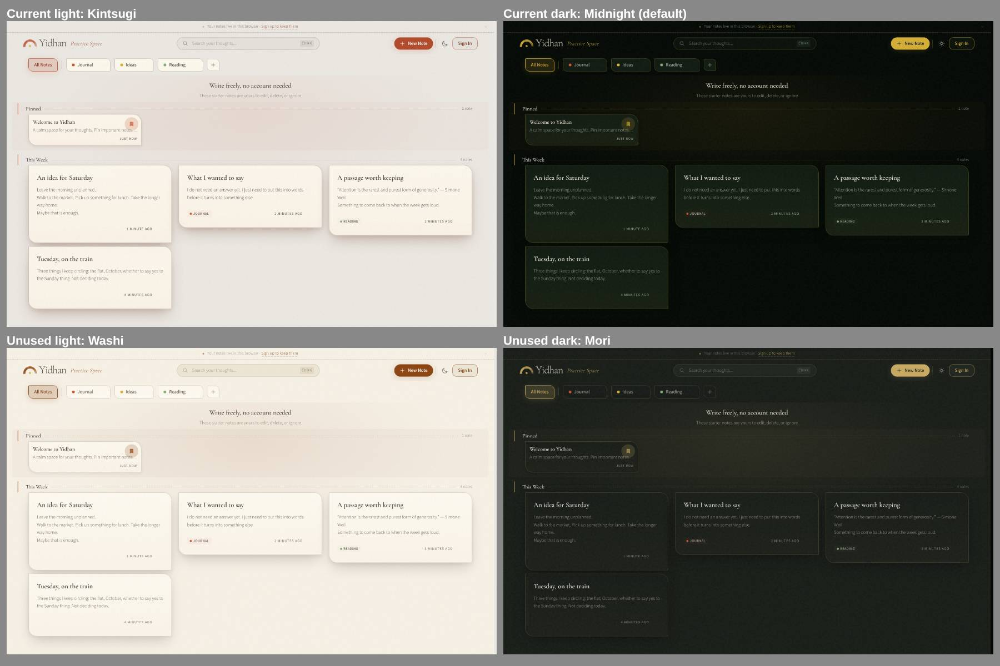

# Design review — typography, colour and UI

Date: 2026-11-09
Scope: landing page, demo library and editor, both shipping themes, at 1440×900 and 390×844
Question: does the visual design read as generic AI output? Are the two colour schemes right?
Outcome: findings only. Nothing changed yet. No decision recorded.

Top row: Kintsugi (light) and Midnight (dark, the default) — what ships today. Bottom
row: Washi and Mori, which are in `src/themes/` but unused.

## Summary

Mostly no. The structure and copy don't read as AI-made. The colour schemes are the
weakest part, and Midnight is the worst of them.

## What works

- **Copy.** "Leave the morning unplanned", "Your words stay yours", "Faded Notes". It
  is specific and calm and does not sell. This does more than anything else to make
  the app feel made by a person.
- **Landing layout.** No gradient hero, no grid of feature icons, no testimonials, no
  emoji. The hero shows a working editor, not a mockup.
- **Editor page.** Quiet and well spaced. The best screen in the app.

## Colour schemes

### Midnight (dark, the default)

- `#050A06` looks black on screen. `DESIGN.md` says dark themes use "deep forest green
  rather than pure black"; the green only shows on cards.
- `#D4AF37` is the stock "metallic gold" hex. Near-black plus bright gold is the
  standard "premium" palette of crypto dashboards and AI-generated luxury mockups. It
  does not match the Muji and Kinfolk references.
- Every card, pill, button and the search box has a gold outline (`--glass-border` is
  gold at 25%). The library looks like a trading app, not a notebook.
- As the default, it is the first thing most visitors see.

### Kintsugi (light)

- Terracotta `#BF5432` on greige with a light serif is very close to Anthropic's
  Claude.ai palette, which many AI products now copy. People who use AI tools will
  notice.
- The page `#EBE8E4` is grey-beige but the cards are a yellower cream. They read as
  two materials that don't match.
- The pinned band gets a pink tint that looks muddy.

### The pair

- The light accent is terracotta and the dark accent is gold, so switching themes
  changes the brand colour and the logo arc.
- Kintsugi means gold repair, but the theme called Kintsugi has no gold. The gold is in
  the dark theme.

### Recommendations

1. **Make Mori the dark default.** Its background `#181D18` reads as dark green, and
   its gold `#C9A962` is aged and muted. It is much calmer. One command:
   `npm run theme:generate -- --theme kintsugi mori`.
2. **Pick one accent colour for both themes.** Either a muted gold in both, which fits
   the name, or a terracotta in dark mode too. Gold is the stronger case: the logo seed
   is already gold (`--color-brand-gold`).
3. **Remove the gold outlines in dark mode.** Separate cards from the page with a
   lighter surface colour instead.
4. **Light theme:** Washi is warmer and doesn't look like Claude.ai, but its brown
   accent is a little muddy. Middle ground: Washi's cream background with a deeper,
   less orange persimmon accent.

## Other AI-template patterns

In rough order of how much they show:

1. **Glows.** A coloured shadow under CTA buttons, a radial glow in the editor, a
   tinted band behind Pinned. Glow under buttons is a very common AI-template detail.
   Keep the editor glow; drop the rest.
2. **Small uppercase labels with letter spacing.** "2 MINUTES AGO", "JOURNAL",
   "JUST NOW". A stock template pattern. Normal-case small text would be calmer.
3. **Section headings carry a coloured left bar plus a dashed rule.** With the dotted
   link underlines, that is three divider styles in one row.
4. **Red, yellow and green tag dots.** At a glance they read as traffic lights.
5. **Body text is too light.** Landing paragraphs use Source Sans 3 at weight 300 in
   grey and look washed out. Use 400 for body; keep 300 for large headings.
6. **Cormorant Garamond is the default "elegant" serif.** It works for large headings.
   At card-title size its small x-height makes it look thin. Keep it, but set card
   titles slightly larger or at weight 500.
7. **The asymmetric card corner** (`2px 24px 4px 24px`) is on every card, so it reads
   as a template rather than imperfection, and makes cards look like speech bubbles.
   Lower priority.
8. **The editor's side toolbar** mixes symbols (B, I, `</>`) with tiny text labels
   ("List", "Quote") that are hard to read.

## Suggested order

1. Theme change — Mori as the dark default and one accent colour — as its own PR with a
   `DECISIONS.md` entry and a `DESIGN.md` update.
2. Cleanup of glows, uppercase labels and dividers.

## How the screenshots were taken

Dev server with placeholder Supabase env vars; `/`, `/demo` and the first demo note,
captured with Playwright. Washi and Mori were rendered by running
`scripts/generate-theme-css.ts --theme washi mori`, then restoring `src/index.css`.
